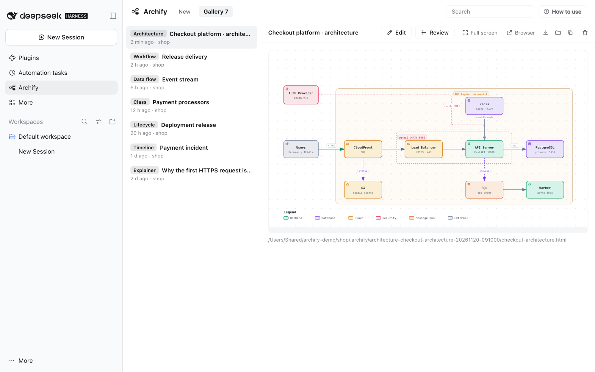
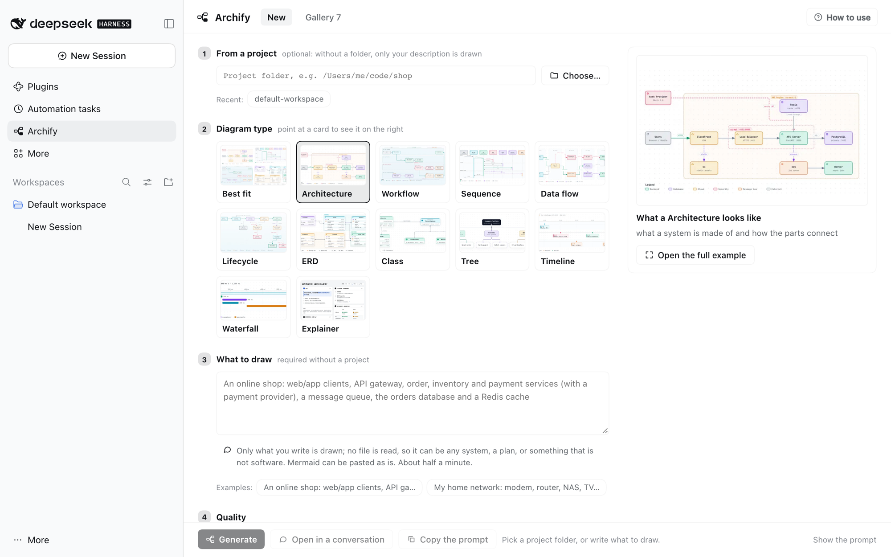
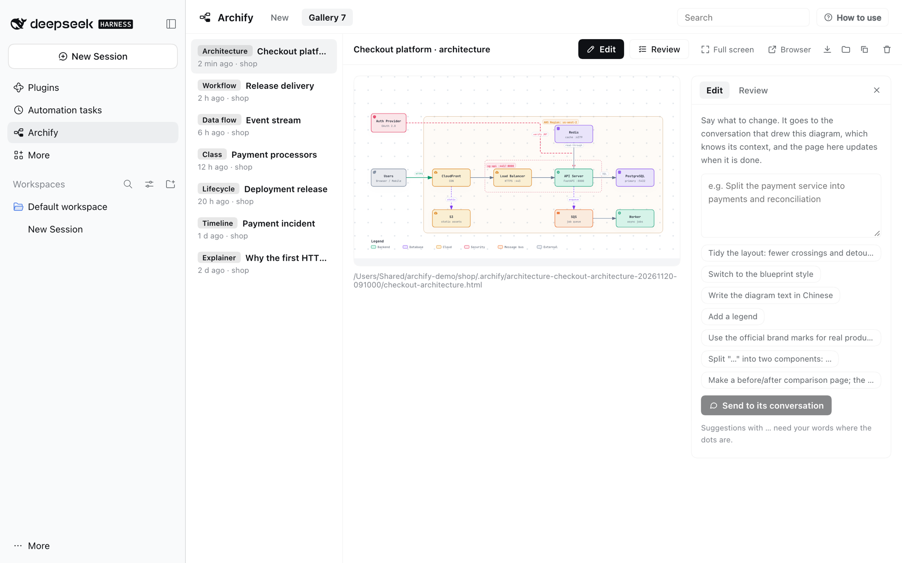
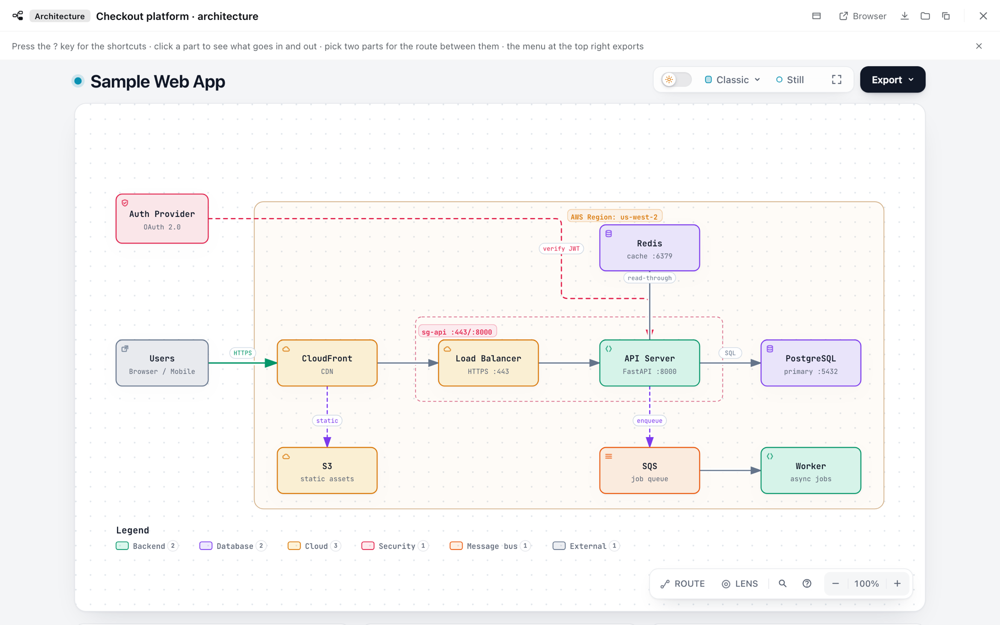
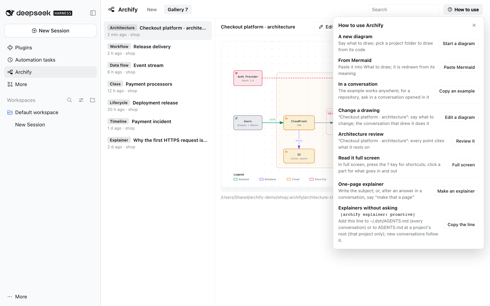

# Archify

English | [简体中文](README.zh-CN.md)

**Ask for a diagram and get a checked, interactive page right in the conversation.**

Brings [Archify](https://github.com/tt-a1i/archify) by tt-a1i to DeepSeek Harness: architecture, workflow, sequence,
data-flow, state, ER, class, tree, timeline and waterfall diagrams, drawn from a description, from Mermaid or from
your code, and one-page explainers made from an answer. No Node.js install, no keys, no extra model calls.



## Install

Add the [DSH Plugins](https://github.com/kadaliao/dsh-plugins) index in DeepSeek Harness (**Plugins → Discover → Sources**):

```
https://raw.githubusercontent.com/kadaliao/dsh-plugins/main/marketplace.json
```

then install **Archify**. The Discover tab is part of the experimental **Custom plugin markets**
feature; turn it on under **Plugins → Experimental plugins** if you don't see it.

Without Discover, paste the package name into the plugin manager:

```
@kadaliao/dsh-archify
```

Or from a terminal with the `dsh` CLI (`--profile desktop` for the desktop app; restart Harness
afterwards):

```
dsh plugin --profile web add @kadaliao/dsh-archify
```

For the latest unreleased code, use the Git spec `git+https://github.com/kadaliao/dsh-archify.git#main` instead.

Refresh the page once after installing. There is nothing to configure: no Node.js install, no
key, no model of its own. Archify runs with the Harness's own JavaScript runtime.

## Updates

Each time you open the Archify panel, the plugin checks whether a newer version of itself is out;
opening it again within a minute reuses the answer, and nothing checks in the background. The check
goes through Harness's own plugin manager, the same check as the Versions section in **Plugins**, and
asks the npm registry only about this package. A newer version shows as a bar across the top of the
panel. **Update** has Harness install it, after checking that it works with your Harness; if the
install fails, the version you had is put back. While it updates, the panel closes, and it opens again
once the new version is in. **Later** hides the bar for a day, **Skip this version** until the next
one. Copies installed from a folder or from Git are not checked.

## How to use it

**Ask in a conversation.** "Draw the architecture of this repo", "draw this as a sequence diagram: …", "make the
answer above a one-page explainer". The model writes the diagram, the plugin renders and checks it, and the page
appears above the reply. Ask about a repository in a conversation opened in that project.

**Or use the panel.** **Archify** in the sidebar (or `/archify`) → **New**: pick a type, a project folder if it
should be drawn from code, say what to draw (or paste Mermaid), and press **Generate**. The plugin scans the
repository, starts the conversation and shows its progress; the page lands in the **Gallery**.



- With a project, the model reads that code and the diagram cites its sources; about 1–2 minutes. Without one, it
  draws only what you wrote; about half a minute.
- **Open in a conversation** puts the same prompt in a new conversation for you to send; **Copy prompt** works in
  any conversation.

**Edit and review.** Select a diagram in the Gallery and press **Edit**: say what to change, or start from a
suggestion. It goes to the conversation that drew the diagram, and the page updates when it is done. An architecture
also has **Review**: the model reads the code, every point cites files and lines, and the plugin checks each
citation and keeps only the points that check out.



**Read it full screen.** Double-click a diagram or press **Full screen**: themes, motion, search, path tracing, and
export to PNG, SVG or WebM. Every page is one HTML file that opens offline and can be sent to anyone.



**Forgot how?** **How to use** at the top right of the panel lists each task in a line, with a button that takes
you to where it is done.



**Explainers without asking.** Add the line `[archify explainer: proactive]` to `~/.dsh/AGENTS.md` (every
conversation) or to `AGENTS.md` at a project's root (that project only); new conversations follow it.

## Fast by default

- The plugin lays out architecture diagrams; the model only writes the boxes and arrows.
- Schema slips and repository evidence are fixed by the plugin before checking, so they do not cost a failed round.
- One repository scan gives the model the whole picture and a code map, so it does not explore file by file.
- Measured with DeepSeek-V4.1-Flash, one run each, as a guide only: an architecture from a description in about
  25 seconds; from a repository of about 4,000 lines in about 100 seconds.

How each of these works, where files go, what is read and sent, the tools' parameters and the bundled Archify
version are in [Details](https://github.com/kadaliao/dsh-archify/blob/main/docs/details.md).

## Settings

On the plugin's row in your profile patch (`cordis.patch.yml`):

| Key | Default | What it does |
| --- | --- | --- |
| `enabled` | `true` | `false` offers neither tool to the model. |
| `skill` | `true` | `false` leaves the `archify` skill out of the catalog. |
| `timeoutMs` | `240000` | How long one Archify run may take. |
| `workdir` | `~/.dsh/archify/workspace` | Where a diagram of a description started from the panel is drawn. |

## If something looks wrong

- **The model runs `node …/archify.mjs` in a shell instead of the tool.** Another `archify` skill
  is winning: personal and project skills (`~/.dsh/skills/archify`,
  `~/.agents/skills/archify`, or `.dsh/skills` / `.agents/skills` in the project) outrank a plugin's. Rename or remove that copy to use this one.
  Installing the separate `@tt-a1i/archify-dsh` package next to this plugin also gives two
  `archify` skills; keep one.
- **The browser check says skipped.** No Chrome, Chromium or Edge is installed. The page is still
  delivered; only that gate did not run. Set `ARCHIFY_CHROME` to a browser's executable to use
  another one.
- **An architecture diagram has many crossings.** Some systems are tangled: a main path that runs
  in and out of a large group crosses itself whatever the layout. Ask for a tidy-up, or for fewer
  or smaller groups.
- **A dense diagram looks busy.** It was probably delivered at the `standard` profile after the
  repair budget. Ask for a tidy-up, or for a higher-level diagram with fewer nodes.
- **The panel says a file is gone.** The page was moved or deleted from the working directory.
- **Generate is greyed out.** This Harness does not let a plugin start conversations; **Open in a
  conversation** still works.
- **A run ended without a page.** Open its conversation: the model may be asking you something, or
  the folder had nothing to draw (it will not invent services an empty folder does not have).

## License

The plugin is MIT. `archify/` is Apache-2.0 with historical MIT grants, by tt-a1i: see its
`LICENSE`, `LICENSE-MIT`, `NOTICE` and `THIRD_PARTY_NOTICES.md`, and this plugin's
[NOTICE](https://github.com/kadaliao/dsh-archify/blob/main/NOTICE). `vendor/elkjs/` is used under the Eclipse Public License 2.0 (elkjs is offered
under EPL-2.0 or GPL-3.0-or-later): see `vendor/elkjs/LICENSE.md`.
