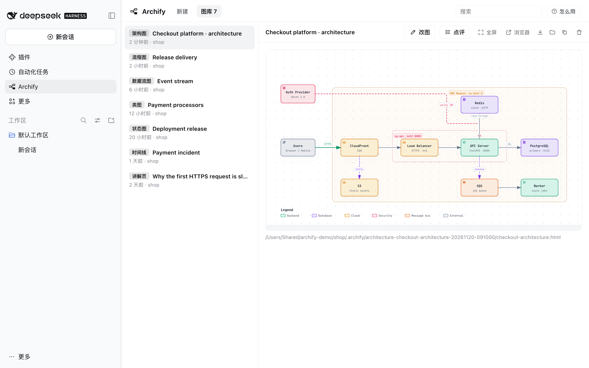
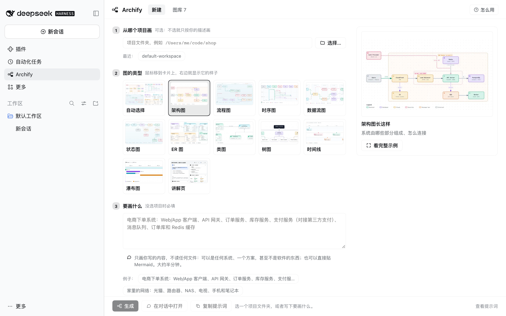
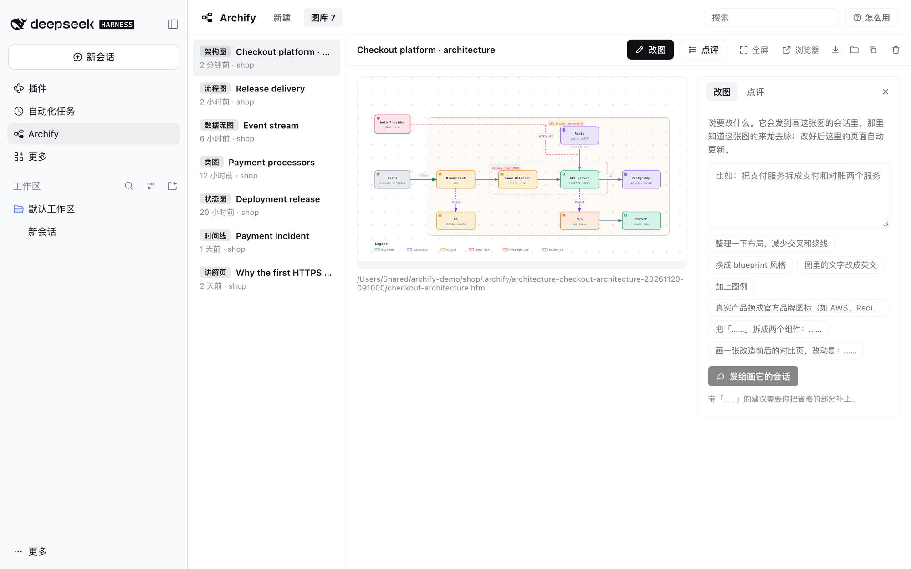
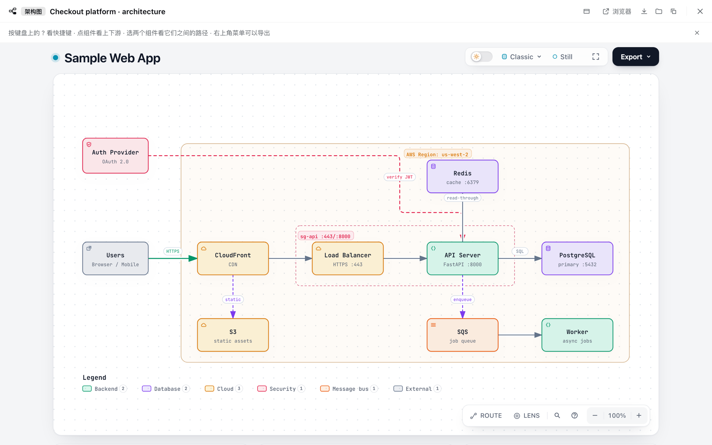
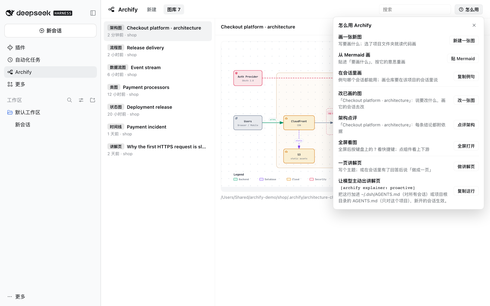

# Archify 图解

[English](README.md) | 简体中文

**说一句要什么图，对话里就出现一张检查过、能交互的图解页面。**

把 tt-a1i 的 [Archify](https://github.com/tt-a1i/archify) 带进 DeepSeek Harness：架构图、流程图、时序图、数据流图、
状态图、ER 图、类图、树图、时间线、瀑布图，照描述、Mermaid 或你的代码来画，也能把一个回答做成一页讲解。
不用装 Node.js，不用填密钥，也不另调模型。



## 安装

在 DeepSeek Harness 里添加 [DSH Plugins](https://github.com/kadaliao/dsh-plugins) 的索引（**插件 → 发现 → 来源**）：

```
https://raw.githubusercontent.com/kadaliao/dsh-plugins/main/marketplace.json
```

然后安装 **Archify 图解**。「发现」页属于实验功能 **自定义插件市场**，看不到的话先在
**插件 → 实验性插件** 里打开。

不用「发现」页的话，把包名粘贴到插件管理器：

```
@kadaliao/dsh-archify
```

也可以在终端里用 `dsh` 命令行装（桌面版用 `--profile desktop`，装完重启 Harness）：

```
dsh plugin --profile web add @kadaliao/dsh-archify
```

想用还没发布的最新代码，改用 Git 地址 `git+https://github.com/kadaliao/dsh-archify.git#main`。

装好后刷新一次页面。不需要任何配置：不用装 Node.js，不用填密钥，也不另调模型。Archify 直接用 Harness
自带的 JavaScript 运行时跑。

## 怎么用

**在对话里说。** 「画一下这个仓库的架构图」「把下面这段画成时序图：……」「把上面的回答做成一页」。模型写好图，
插件渲染并检查，页面直接显示在回复上面。画仓库要在打开了该项目的会话里说。

**或者在面板里点。** 左侧栏的 **Archify**（或输入 `/archify`）→ **新建**：选图的类型，想从代码画就再选项目文件夹，
写一句要画什么（也可以直接贴 Mermaid），点 **生成**。插件扫描仓库、开会话、显示进度，画好的页面收进 **图库**。



- 选了项目：模型读那份代码，图里标出依据的源码，大约 1–2 分钟。不选：只画你写的内容，大约半分钟。
- **在对话中打开** 把同样的提示词填进新会话，由你确认发送；**复制提示词** 可以贴到任何会话。

**改图和点评。** 在图库选中一张图，点 **改图**，说要改什么或从建议开始；它发给画这张图的会话，改好后页面自动更新。
架构图还有 **点评**：模型读代码评审，每条结论都附文件和行号，插件逐条核对，核对不过的不保存。



**全屏看图。** 双击图或点 **全屏**：主题、动效、搜索、路径追踪，导出 PNG、SVG、WebM。每个页面都是独立的 HTML
文件，离线能开，可以直接发给别人。



**忘了怎么用。** 面板右上角的 **怎么用** 把每件事列成一行，点按钮直接到做这件事的地方。



**让模型主动出讲解页。** 在 `~/.dsh/AGENTS.md`（所有会话）或项目根目录的 `AGENTS.md`（只对这个项目）里加一行
`[archify explainer: proactive]`，新开的会话生效。

## 默认就快

- 架构图由插件排版，模型只写有哪些框和箭头。
- 格式小错和仓库来源信息在检查前由插件修好，不用失败一次再修一轮。
- 画仓库时一次扫描给出全貌和代码地图，模型不用四处翻代码。
- 实测（DeepSeek-V4.1-Flash，各跑一次，仅供参考）：照描述画架构图约 25 秒，读一个约 4000 行的仓库画约 100 秒。

每一项怎么做的、文件放在哪、读什么发什么、工具参数、内置的 Archify 版本，见 [细节](https://github.com/kadaliao/dsh-archify/blob/main/docs/details.zh-CN.md)。

## 设置

在 profile 补丁（`cordis.patch.yml`）里本插件的那一行：

| 键 | 默认值 | 作用 |
| --- | --- | --- |
| `enabled` | `true` | 设为 `false` 时不向模型提供任何工具。 |
| `skill` | `true` | 设为 `false` 时技能目录里没有 `archify` 技能。 |
| `timeoutMs` | `240000` | 一次 Archify 运行最长多久。 |
| `workdir` | `~/.dsh/archify/workspace` | 从面板按描述画图时，在哪个文件夹里画。 |

## 看起来不对时

- **模型在 shell 里跑 `node …/archify.mjs`，没用工具。** 有另一个 `archify` 技能优先了：个人和项目里的
  技能（`~/.dsh/skills/archify`、`~/.agents/skills/archify`，或项目里的 `.dsh/skills`、`.agents/skills`）排在插件自带的前面。把那一份改名或删掉
  就会用这一份。另外装了 `@tt-a1i/archify-dsh` 包的话，也会有两个 `archify` 技能，留一个就好。
- **浏览器检查显示跳过。** 这台机器没装 Chrome、Chromium 或 Edge。页面照样生成，只是这一道检查没跑。
  想用别的浏览器，把 `ARCHIFY_CHROME` 设成它的可执行文件路径。
- **架构图交叉很多。** 有些系统本身就缠在一起：主链路在一个大分组里进进出出，怎么排都会交叉。
  让模型整理一下布局，或者少分几组、把组分小。
- **复杂的图看起来很乱。** 多半是用完修复预算后按 `standard` 档交付的。让模型整理一下布局，或者画一张
  层次更高、节点更少的图。
- **面板里显示文件已不在。** 页面被移走或从工作目录里删掉了。
- **「生成」是灰的。** 这个 Harness 不允许插件开会话；**在对话中打开** 仍然可用。
- **运行结束了却没出图。** 打开它的会话看看：模型可能在问你问题，或者那个文件夹里没东西可画（空文件夹里
  没有的服务，它不会编出来）。

## 许可

插件本身是 MIT。`archify/` 是 tt-a1i 的作品，Apache-2.0 并保留历史上的 MIT 授权，见其中的 `LICENSE`、
`LICENSE-MIT`、`NOTICE`、`THIRD_PARTY_NOTICES.md`，以及本插件的 [NOTICE](https://github.com/kadaliao/dsh-archify/blob/main/NOTICE)。`vendor/elkjs/` 按
Eclipse Public License 2.0 使用（elkjs 以 EPL-2.0 或 GPL-3.0-or-later 授权），见 `vendor/elkjs/LICENSE.md`。
